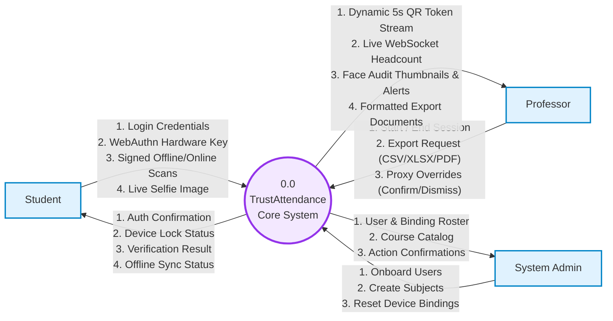
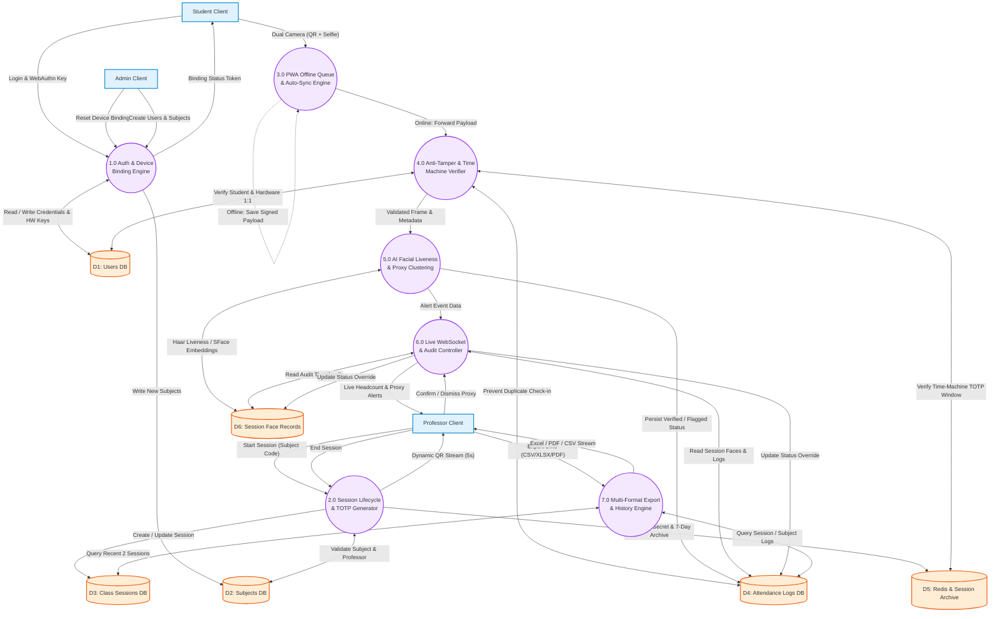

# Data Flow Diagrams (DFD)

_**Project**: TrustAttendance: Offline-First, Proxy-Free College Attendance System_  
_**Course**: System Design Tools and Techniques (SDTT)_

---

## 1. Level 0 DFD (System Context Diagram)

**Purpose**: The Context Diagram establishes the boundary of the TrustAttendance system. It portrays the entire application as a single high-level process (`0.0`) interacting with external actors (**Student**, **Professor**, and **Admin**).

### Entities & Information Flows

- **Student**:
  - *Inputs to System*: Login credentials, WebAuthn platform authenticator credentials, scanned dynamic TOTP tokens, client timestamps, SHA-256 digital signatures, front-facing selfie camera frames.
  - *Outputs from System*: Device binding confirmation, real-time verification response, offline queue status, toast notifications.
- **Professor**:
  - *Inputs to System*: Course selection, start/end session commands, proxy confirmation or dismissal actions, export format requests (`csv`, `excel`, `pdf`).
  - *Outputs from System*: 5-second dynamic TOTP QR stream, real-time live attendance feed, student selfie thumbnails with bounding boxes, facial proxy alerts, multi-format attendance reports.
- **Admin**:
  - *Inputs to System*: User creation (Students, Professors), course subject creation, 1:1 hardware device binding reset requests.
  - *Outputs from System*: User listings with binding statuses, subject listings, system administrative confirmations.

### Level 0 Visual Diagram (Mermaid)

---

## 2. Level 1 DFD (Sub-Process Decomposition)

**Purpose**: The Level 1 DFD decomposes the central system into distinct functional sub-processes (`1.0` through `7.0`) and shows how data is written to and read from the underlying data stores.

### Data Stores (D1 – D6)

- **D1: Users Store**: Student, Professor, and Admin records, salted password hashes, and 1:1 `hardware_id` locks.
- **D2: Subjects Store**: Course codes, names, and academic department details.
- **D3: Class Sessions Store**: Session start/end timestamps, associated subject, professor ID, and active status flag.
- **D4: Attendance Logs Store**: Verified check-ins, student IDs, session IDs, timestamps, tokens used, and status badges (`verified`, `flagged_proxy`, `flagged_no_face`, `confirmed_proxy`).
- **D5: Redis Cache & 7-Day Session Archive**: Active session TOTP secrets, 2-hour active TTL keys, and 7-day session archives for time-machine verification.
- **D6: Session Face Records Store**: In-memory and persisted JSON records containing SFace 128D embeddings, cosine similarity pairings, and compressed audit thumbnails.

---

### Level 1 Sub-Process Map (Mermaid)

---

## 3. Sub-Process Functional Breakdown

### Process 1.0: Authentication & Device Binding Engine
- Validates user email and salted bcrypt password hashes against **D1**.
- Facilitates 1:1 device binding via the WebAuthn standard:
  - If a student tries to bind a second phone while an existing `hardware_id` is present, raises HTTP 403.
  - If a student tries to bind a phone already bound to another student ID, raises HTTP 403.
- Provides administrators with an explicit unlock route to clear `hardware_id` upon verified device loss.

### Process 2.0: Session Lifecycle & Dynamic TOTP Engine
- Receives professor session start requests, marks past sessions inactive in **D3**, and commits a new active session.
- Generates a random base32 secret via PyOTP and writes it to **D5** under `session:{subject_code}` with a 2-hour TTL.
- Copies the secret to `session_archive:{session_id}` with a 7-day retention period.
- Serves dynamic TOTP tokens every 5 seconds to the professor's projected browser display.

### Process 3.0: PWA Offline Queue & Auto-Sync Engine
- Coordinates rear-camera QR code decoding (`Html5Qrcode`) and automatically triggers the front-camera selfie capture.
- Signs the payload using the client's Web Crypto API (`SHA-256(student_id:token:timestamp)`).
- When offline, serializes the package and stores it in the local browser IndexedDB (`offline-queue`).
- Monitors the browser's `online` event with a 1.5-second debounce to drain the queue when connectivity is restored.

### Process 4.0: Cryptographic Payload & Time-Machine Verifier
- Verifies the incoming payload's digital signature against the client timestamp.
- Evaluates the TOTP token against the active session secret or past session archives in **D5** using `pyotp.verify(valid_window=60, for_time=client_time)`.
- Validates the incoming `hardware_id` against the student's registered `hardware_id` in **D1**.
- Checks **D4** to ensure the student has not already logged an attendance entry for the active session.

### Process 5.0: AI Facial Liveness & Proxy Clustering
- Runs Haar Cascade face detection on the decoded base64 camera frame. Checks aspect ratio and pixel standard deviation ($\ge 16.0$) to reject walls, blacked-out lenses, or finger coverings.
- If no face is detected, stamps an alert thumbnail with a hazard frame, records `flagged_no_face` in **D4**, and halts execution.
- If a valid face is detected, extracts a 128D embedding vector using SFace ONNX.
- Executes cosine similarity matching against all previously saved face vectors for that session in **D6**. If similarity $\ge 0.68$ with a different student ID, flags both as `flagged_proxy`.

### Process 6.0: Real-time WebSocket & Audit Controller
- Maintains an open WebSocket connection with the professor's dashboard (`/ws/session/{subject_code}`).
- Broadcasts `NEW_ATTENDANCE` and `PROXY_STATUS_UPDATED` JSON events whenever check-ins occur or proxy states change.
- Serves captured face audit records (including face bounding boxes, match similarity scores, and obscured thumbnails) for professor inspection.
- Processes manual professor override actions (`/professor/confirm-proxy` and `/professor/dismiss-proxy`) and updates **D4** and **D6** atomically.

### Process 7.0: Multi-Format Export & History Engine
- Queries **D3** to populate the "Last 2 Sessions" overview card for quick professor reference.
- Streams multi-format reports from **D4**:
  - *Excel (`.xlsx`)*: Formatted workbook with university brand headers, column widths, and highlighted proxy flags via OpenPyXL.
  - *PDF (`.pdf`)*: Official audit report with custom headers, tabular records, and page counters via FPDF2.
  - *CSV (`.csv`)*: Standard comma-separated format for quick ingestion into external university systems.
