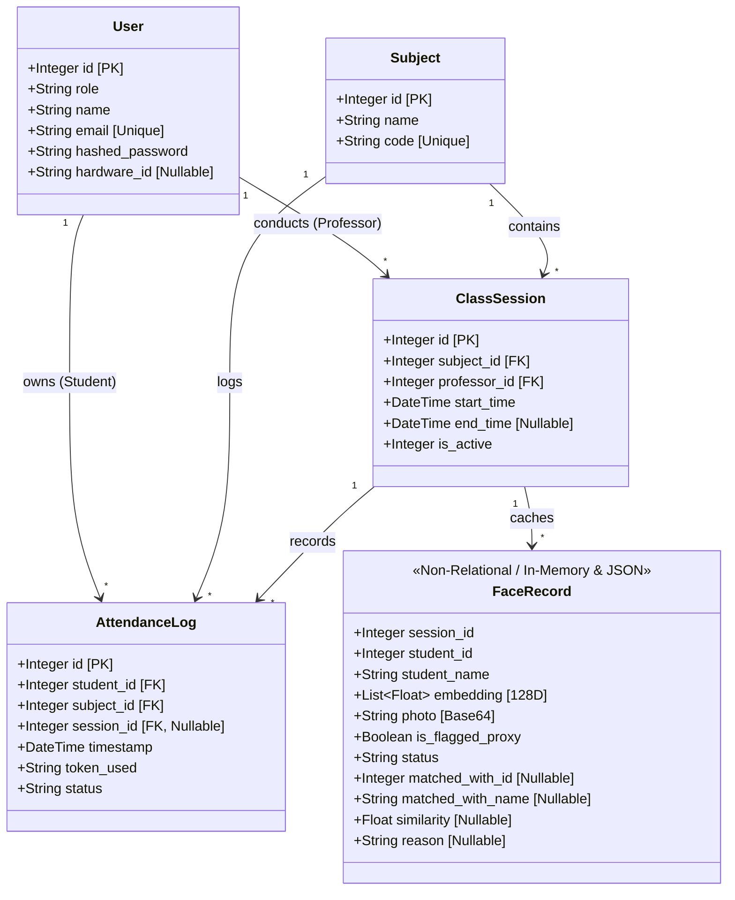
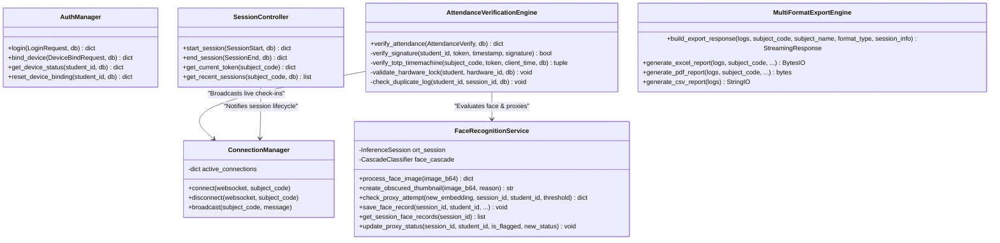
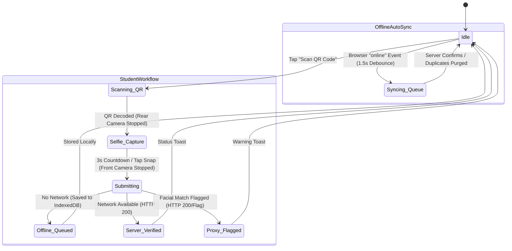

# Low-Level Design (LLD) & Class Diagrams

_**Project**: TrustAttendance: Offline-First, Proxy-Free College Attendance System_  
_**Course**: System Design Tools and Techniques (SDTT)_

---

This document details the Object-Oriented Low-Level Design (LLD) of the TrustAttendance platform, defining the core domain models, the backend service layer, the client-side PWA managers, and the software design patterns implemented across the project.

---

## 1. Core Domain Models (Database Entities)

The persistence layer is mapped via SQLAlchemy 2.0 ORM to a PostgreSQL database (Neon Serverless). The diagram below illustrates the entity relations and data types.

### Entity Attributes & Data Types

1. **User**:
   - `id`: Auto-incrementing primary key.
   - `role`: Role identifier (`'admin'`, `'professor'`, `'student'`).
   - `name`: Full display name.
   - `email`: Institutional email address (unique index).
   - `hashed_password`: Salted bcrypt string.
   - `hardware_id`: WebAuthn credential ID or platform hardware fingerprint.
2. **Subject**:
   - `id`: Auto-incrementing primary key.
   - `name`: Subject name (e.g., "Software System Design").
   - `code`: Subject alphanumeric code (e.g., `"CS301"`).
3. **ClassSession**:
   - `id`: Session sequence identifier.
   - `subject_id`: Foreign key reference to `Subject`.
   - `professor_id`: Foreign key reference to `User`.
   - `start_time`: UTC timestamp of session creation.
   - `end_time`: UTC timestamp of session termination.
   - `is_active`: Binary status flag (`1` for active, `0` for concluded).
4. **AttendanceLog**:
   - `id`: Log primary key.
   - `student_id`: Foreign key reference to student `User`.
   - `subject_id`: Foreign key reference to `Subject`.
   - `session_id`: Foreign key reference to `ClassSession`.
   - `timestamp`: UTC scan time (or student's verified offline timestamp).
   - `token_used`: Cleaned TOTP token string captured by scanner.
   - `status`: Verification state (`"verified"`, `"flagged_proxy"`, `"flagged_no_face"`, `"confirmed_proxy"`).

---

## 2. Backend Service Layer (FastAPI Controllers)

The backend business logic is partitioned into modular service controllers:

### Detailed Method Specifications

#### `AttendanceVerificationEngine.verify_attendance`
- **Signature Integrity**: Computes $\text{SHA-256}(\text{student\_id} : \text{token} : \lfloor\text{timestamp}\rfloor)$ and verifies client proof.
- **Time-Machine TOTP Validation**:
  1. Checks active session secret in Redis (`session:{subject_code}`).
  2. If inactive or token drifted due to offline delay, queries the last 5 sessions for that subject and checks `session_archive:{session_id}`.
  3. Uses `pyotp.TOTP.verify(token, valid_window=60, for_time=client_time)`.
- **1:1 Hardware Check**: Blocks submission if `student.hardware_id` differs from payload `hardware_id`.
- **Duplicate Check**: Prevents students from scanning twice in the same session.
- **Face Liveness & Evasion Filter**: Dispatches frame to `FaceRecognitionService`. If no face is visible, flags as `flagged_no_face` and raises HTTP 400.
- **Intra-Session Proxy Check**: If face matches another student in the same session ($\ge 0.68$), both are updated to `flagged_proxy`.

---

## 3. Client-Side (React PWA) Architecture

### Client Module Responsibilities

1. **`db.js` (IndexedDB Wrapper via `idb`)**:
   - Database name: `TrustAttendanceDB` (version 1).
   - Object store: `offline-queue` with auto-incrementing key `id`.
   - Exposes `saveOfflineAttendance()`, `getOfflineAttendance()`, `deleteOfflineRecord()`, and `clearOfflineQueue()`.
2. **Web Crypto Signature Generator (`generateSignature`)**:
   - Invokes `window.crypto.subtle.digest('SHA-256', ...)` directly in the browser thread.
   - Prevents student tampering of offline attendance payload timestamps.
3. **WebAuthn Platform Controller (`handleBindDevice`)**:
   - Calls `navigator.credentials.create({ publicKey: ... })` requesting `platform` authenticator attachment.
   - Stores credential ID in `localStorage` and binds it 1:1 on the server.
4. **Dual-Camera Controller**:
   - Step 1: Launches `Html5Qrcode` with `{ facingMode: 'environment' }` for the rear lens.
   - Step 2: Unmounts rear camera stream and starts front camera via `navigator.mediaDevices.getUserMedia({ video: { facingMode: 'user' } })`.
   - Triggers automatic 3-second countdown timer before drawing video frame to an HTML5 canvas (`image/jpeg`, 0.85 quality).

---

## 4. Software Design Patterns Utilized

1. **Singleton Pattern**:
   - `ConnectionManager`: Single central instance coordinates WebSocket channel routing across FastAPI worker threads.
   - `ort_session`: Single ONNX InferenceSession instance loads SFace neural weights once to avoid memory bloat.
   - `redis_db`: Central connection pool handles Redis commands with automatic fallback.
   - `TrustAttendanceDB`: Shared IndexedDB connection singleton in the PWA.

2. **Strategy Pattern**:
   - `MultiFormatExportEngine`: Formats attendance records interchangeably using `format_type`:
     - `ExcelStrategy` via OpenPyXL for styled executive spreadsheets.
     - `PDFStrategy` via FPDF2 for audit compliance documents.
     - `CSVStrategy` for lightweight data exports.

3. **State Machine Pattern**:
   - PWA Student scanning workflow strictly models discrete transitions: `idle` $\to$ `scanning_qr` $\to$ `selfie_capture` $\to$ `submitting` $\to$ `idle`.

4. **Observer Pattern**:
   - WebSockets publish-subscribe channel (`/ws/session/{subject_code}`) notifies professor dashboards immediately when check-in events or proxy overrides occur.

5. **Graceful Degradation Pattern**:
   - **Cache Degradation**: Transparently switches to `InMemoryRedis` if external Redis is unreachable.
   - **Biometric Degradation**: Falls back to grayscale histogram vector comparison if the ONNX model cannot be loaded.
   - **Device Lock Degradation**: Falls back to cryptographic UUID generation if browser lacks WebAuthn platform authenticator support.
